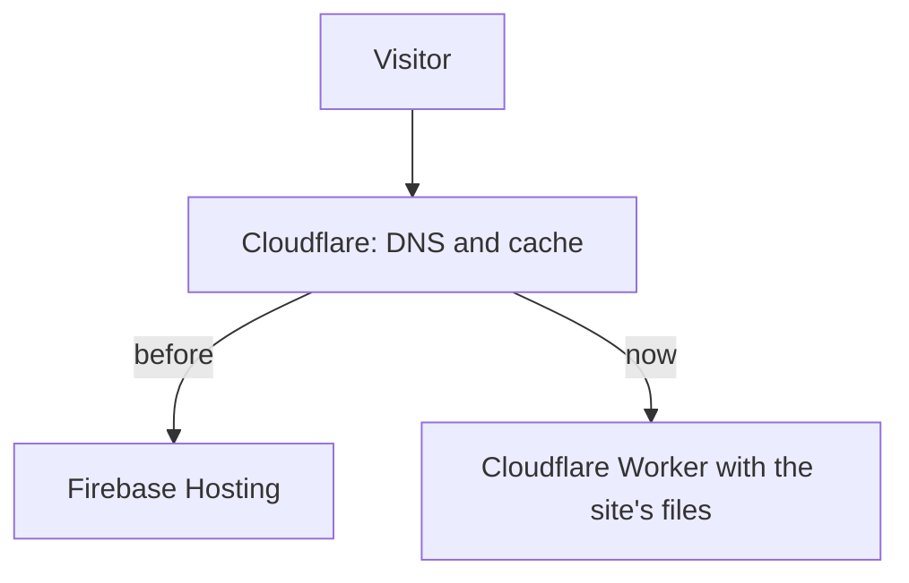

Until today this site ran on Firebase Hosting, while the domain, DNS and email already lived at Cloudflare. Visitors went through Cloudflare first, which then fetched the pages from Firebase. That worked fine, but it meant two providers, two caches and two dashboards for one small static site. Now Cloudflare serves the site itself.



## Why move

Speed wasn't the reason. Both are fast networks, and the pages are already small; I measured that [in the previous post](/posts/2026/10/reijn.dev-measured-79-lighter-and-faster-on-every-page/). The reasons were simpler:

- **One place.** Domain, DNS, email, analytics and hosting now share one dashboard, and the cache I clear is the one visitors actually get.
- **No hard traffic cap.** Firebase's free plan has a daily download limit. If a post ever got popular, the site could simply stop until the next day. Cloudflare doesn't charge or cap static files.
- **A smaller key.** Deploys used a Google Cloud service account key. Now GitHub holds a Cloudflare token that can only manage Workers.
- **Room to grow.** If I ever want a contact form, a small Worker can handle it next to the static pages.

## How it works now

Hugo still builds the site in GitHub Actions. Instead of the Firebase deploy step, [Wrangler](https://developers.cloudflare.com/workers/wrangler/) uploads the `public/` folder to a Worker with [static assets](https://developers.cloudflare.com/workers/static-assets/). There's no server code: Cloudflare serves the files straight from its network.

The whole configuration is a few lines:

```jsonc
{
  "name": "reijn-dev",
  "compatibility_date": "2026-10-15",
  "assets": {
    "directory": "./public",
    "not_found_handling": "404-page"
  },
  "routes": [{ "pattern": "reijn.dev", "custom_domain": true }],
  "preview_urls": true
}
```

The security headers and caching rules moved from `firebase.json` to a `_headers` file, which Hugo copies into the build. One thing to watch out for: when several rules match a URL, Cloudflare merges their headers. If two rules both set `Cache-Control`, a file gets both values. So the security headers live in one rule for all pages, and each file type gets its own caching rule.

Pull requests used to get a Firebase preview channel. Now each one uploads a preview version with its own address, and the live site stays untouched until the merge.

## Testing before switching

I didn't want to find problems on the live site, so the move happened in steps:

1. **Locally.** `wrangler dev` runs the same runtime on my laptop. I checked headers, caching, the 404 page and redirects with `curl`.
2. **On a test address.** A Worker without a domain only gets a `workers.dev` address. reijn.dev stayed on Firebase while I clicked through the copy on Cloudflare.
3. **The switch.** I removed the DNS record pointing to Firebase and merged the pull request. The deploy attached reijn.dev to the Worker and created the certificate itself. The site was offline for about a minute.

The old Firebase deploy kept running for a while, so going back would only have taken one DNS record. That wasn't needed, and Firebase is now gone from the repository.

How do you know where a page comes from? Firebase adds an `x-served-by` header to every response. Before the switch reijn.dev sent it, now it doesn't.

## What I turned on afterwards

With everything in one place, a few settings were one click away:

- **DNSSEC.** DNS answers for reijn.dev are now signed, so resolvers can tell a forged answer from a real one. For the website HTTPS already covered this, but email routing benefits too.
- **AI Crawl Control.** The content on this site is [CC BY-NC 4.0](https://creativecommons.org/licenses/by-nc/4.0/): free to share, but not for commercial use. Crawlers that collect text to train AI models are now blocked, and `robots.txt` says so as well. Search engines, and AI search tools that link back to the source, are still welcome.
- **Web Analytics.** Cloudflare counts visits without cookies and without tracking people across sites. The script it adds is allowed in the Content Security Policy, and nothing else is.
- **Minimum TLS 1.2 and a DMARC record**, two small security settings I'd been putting off.

## What I'd do differently

Not much, but two things took longer than they should have. A new Cloudflare account has to claim a `workers.dev` subdomain before the first deploy, and the error message about that isn't very clear. And the dashboard didn't make it easy to attach a domain to a Worker, so I let the deploy do it from the configuration file. That's the better place for it anyway: the setting now lives in Git, next to everything else.
