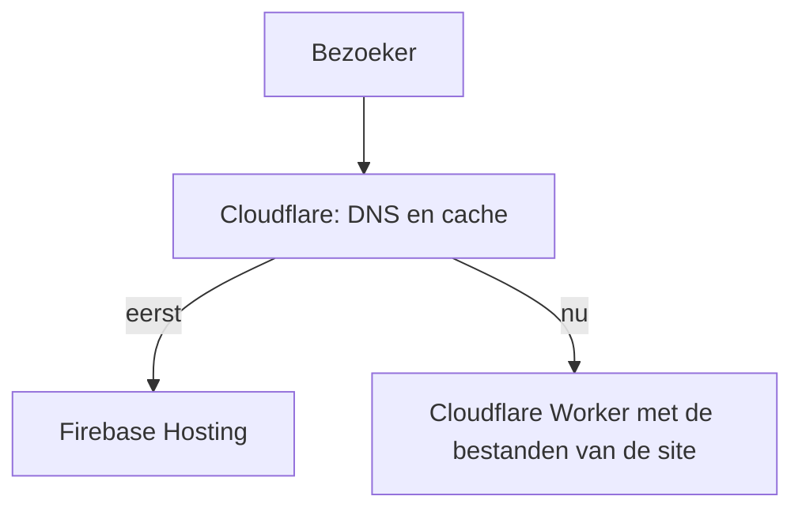

Tot vandaag draaide deze site op Firebase Hosting, terwijl het domein, de DNS en de e-mail al bij Cloudflare stonden. Bezoekers gingen eerst langs Cloudflare, dat de pagina's vervolgens bij Firebase ophaalde. Dat werkte prima, maar het betekende twee aanbieders, twee caches en twee dashboards voor één kleine statische site. Nu levert Cloudflare de site zelf.



## Waarom verhuizen

Snelheid was niet de reden. Het zijn allebei snelle netwerken, en de pagina's zijn al klein; dat heb ik [in de vorige post](/nl/posts/2026/10/reijn.dev-gemeten-79-lichter-en-sneller-op-elke-pagina/) gemeten. De redenen waren eenvoudiger:

- **Eén plek.** Domein, DNS, e-mail, statistieken en hosting staan nu in één dashboard, en de cache die ik leeg maak is ook de cache die bezoekers krijgen.
- **Geen harde limiet op verkeer.** Het gratis plan van Firebase heeft een daglimiet voor downloads. Als een post ooit populair werd, kon de site tot de volgende dag gewoon stoppen. Cloudflare rekent niets en zet geen limiet op statische bestanden.
- **Een kleinere sleutel.** Deploys gebruikten een sleutel van een Google Cloud-serviceaccount. Nu bewaart GitHub een Cloudflare-token dat alleen Workers mag beheren.
- **Ruimte om te groeien.** Als ik ooit een contactformulier wil, kan een kleine Worker dat naast de statische pagina's afhandelen.

## Hoe het nu werkt

Hugo bouwt de site nog steeds in GitHub Actions. In plaats van de Firebase-stap uploadt [Wrangler](https://developers.cloudflare.com/workers/wrangler/) de map `public/` naar een Worker met [static assets](https://developers.cloudflare.com/workers/static-assets/). Er draait geen servercode: Cloudflare levert de bestanden rechtstreeks vanuit zijn netwerk.

De hele configuratie is een paar regels:

```jsonc
{
  "name": "reijn-dev",
  "compatibility_date": "2026-10-15",
  "assets": {
    "directory": "./public",
    "not_found_handling": "404-page"
  },
  "routes": [{ "pattern": "reijn.dev", "custom_domain": true }],
  "preview_urls": true
}
```

De beveiligingsheaders en cacheregels zijn verhuisd van `firebase.json` naar een bestand `_headers`, dat Hugo meekopieert in de build. Eén ding om op te letten: als meerdere regels bij een URL passen, voegt Cloudflare hun headers samen. Zetten twee regels allebei `Cache-Control`, dan krijgt een bestand beide waarden. Daarom staan de beveiligingsheaders in één regel voor alle pagina's, en krijgt elk bestandstype een eigen cacheregel.

Pull requests kregen eerst een preview-kanaal bij Firebase. Nu uploadt elke pull request een previewversie met een eigen adres, en blijft de live site onaangeroerd tot de merge.

## Testen vóór de overstap

Ik wilde problemen niet op de live site ontdekken, dus de verhuizing ging in stappen:

1. **Lokaal.** `wrangler dev` draait dezelfde runtime op mijn laptop. Met `curl` heb ik headers, caching, de 404-pagina en redirects gecontroleerd.
2. **Op een testadres.** Een Worker zonder domein krijgt alleen een `workers.dev`-adres. reijn.dev bleef op Firebase terwijl ik door de kopie op Cloudflare klikte.
3. **De overstap.** Ik verwijderde het DNS-record dat naar Firebase wees en mergede de pull request. De deploy koppelde reijn.dev aan de Worker en maakte zelf het certificaat aan. De site was ongeveer een minuut offline.

De oude Firebase-deploy liep nog even door, zodat teruggaan maar één DNS-record had gekost. Dat was niet nodig, en Firebase is nu uit de repository verdwenen.

Hoe zie je waar een pagina vandaan komt? Firebase zet bij elk antwoord een header `x-served-by`. Vóór de overstap stuurde reijn.dev die mee, nu niet meer.

## Wat ik daarna aanzette

Met alles op één plek waren een paar instellingen één klik verwijderd:

- **DNSSEC.** DNS-antwoorden voor reijn.dev zijn nu ondertekend, zodat resolvers een vervalst antwoord van een echt antwoord kunnen onderscheiden. Voor de website dekte HTTPS dit al af, maar de e-mailroutering heeft er ook baat bij.
- **AI Crawl Control.** De inhoud van deze site valt onder [CC BY-NC 4.0](https://creativecommons.org/licenses/by-nc/4.0/deed.nl): vrij te delen, maar niet voor commercieel gebruik. Crawlers die tekst verzamelen om AI-modellen te trainen worden nu geblokkeerd, en `robots.txt` zegt dat ook. Zoekmachines, en AI-zoektools die naar de bron linken, zijn nog steeds welkom.
- **Web Analytics.** Cloudflare telt bezoeken zonder cookies en zonder mensen over sites heen te volgen. Het script dat het toevoegt is toegestaan in de Content Security Policy, en verder niets.
- **Minimaal TLS 1.2 en een DMARC-record**, twee kleine beveiligingsinstellingen die ik al een tijdje voor me uit schoof.

## Wat ik anders zou doen

Niet veel, maar twee dingen duurden langer dan nodig. Een nieuw Cloudflare-account moet eerst een `workers.dev`-subdomein claimen voor de eerste deploy, en de foutmelding daarover is niet erg duidelijk. En in het dashboard was het niet makkelijk om een domein aan een Worker te koppelen, dus liet ik de deploy dat doen vanuit het configuratiebestand. Dat is sowieso de betere plek: de instelling staat nu in Git, naast al het andere.
