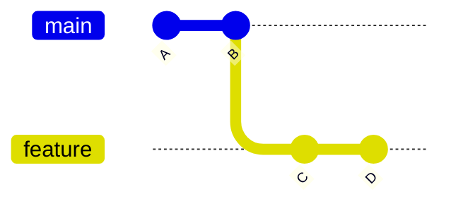
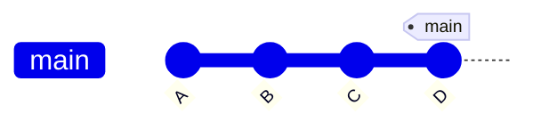
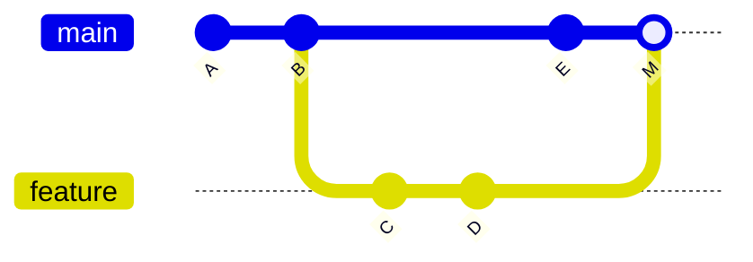
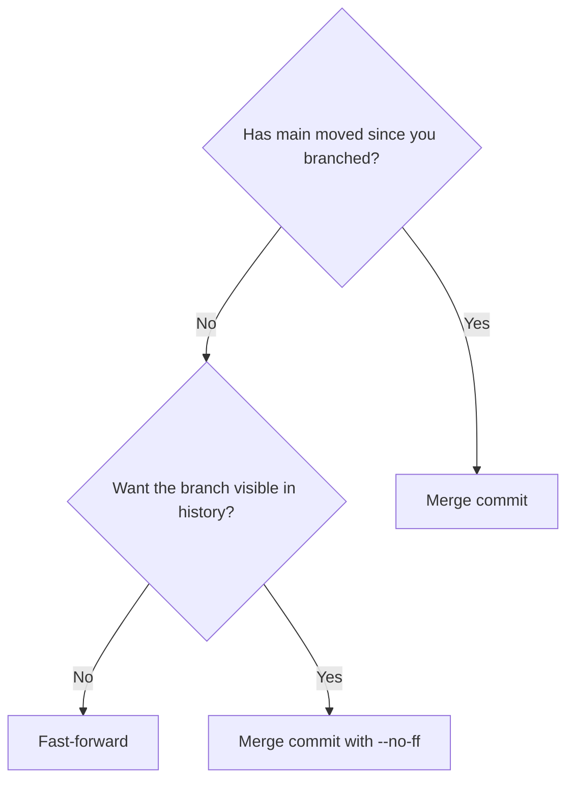
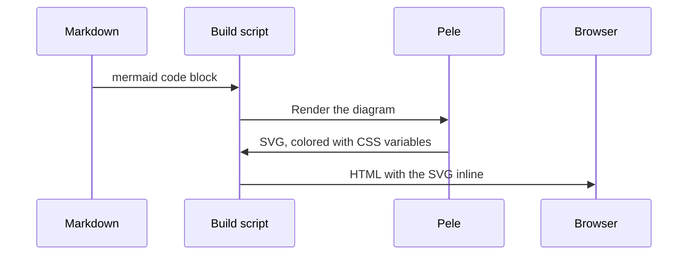

This site now renders diagrams with [Pele](https://pele.run) instead of Mermaid.js. Pele is a small, MIT-licensed library from the Obsidian team that reads the same Mermaid syntax but is a fraction of the size. To give it something to do, here's a question that came up while I was making the switch: what is the difference between a fast-forward and a merge commit?

## The starting point

You branch off `main`, add a couple of commits on `feature`, and want to bring them back.



What Git does next depends on one thing: has `main` moved since you branched off?

## Fast-forward

If `main` has no new commits, Git doesn't need to combine anything. `main` is simply behind, so Git moves the `main` label forward to `D`. No new commit is created, and the history stays one straight line.



The downside is that afterwards you can no longer see that `C` and `D` were ever on a separate branch. Use `git merge --ff-only` if you want Git to refuse anything other than a fast-forward.

## Merge commit

If someone committed `E` to `main` in the meantime, the two histories have diverged and there is no line to slide along. Git creates a new commit `M` with **two parents**, joining both lines.



The merge commit records exactly where and when the branch came in. You can force one even when a fast-forward is possible with `git merge --no-ff`, which some teams prefer so that every feature stays visible as a unit.

## Which one to pick?



Neither is better. A linear history is easier to read with `git log`, and merge commits keep the context of a branch. Pick one convention per repository and stick to it.

## How the diagrams get here

Every diagram above is a plain ```` ```mermaid ```` code block in the Markdown source. When the site is built, a small script renders each one with Pele, and a Hugo render hook puts the result straight into the page:



Your browser downloads no diagram JavaScript at all; with Mermaid.js that was about 1.6 MB. Because the colors are CSS variables, the diagrams still follow the light/dark toggle. Try the toggle at the top of the page.
