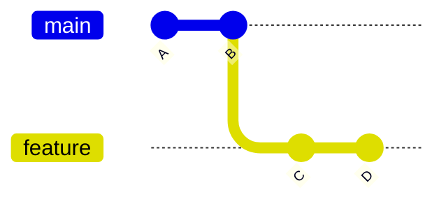
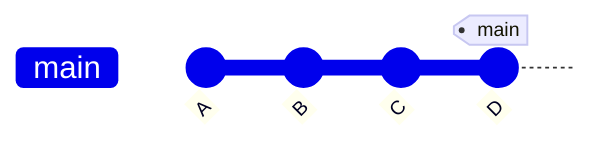
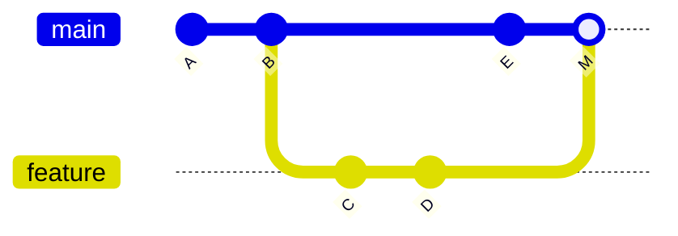
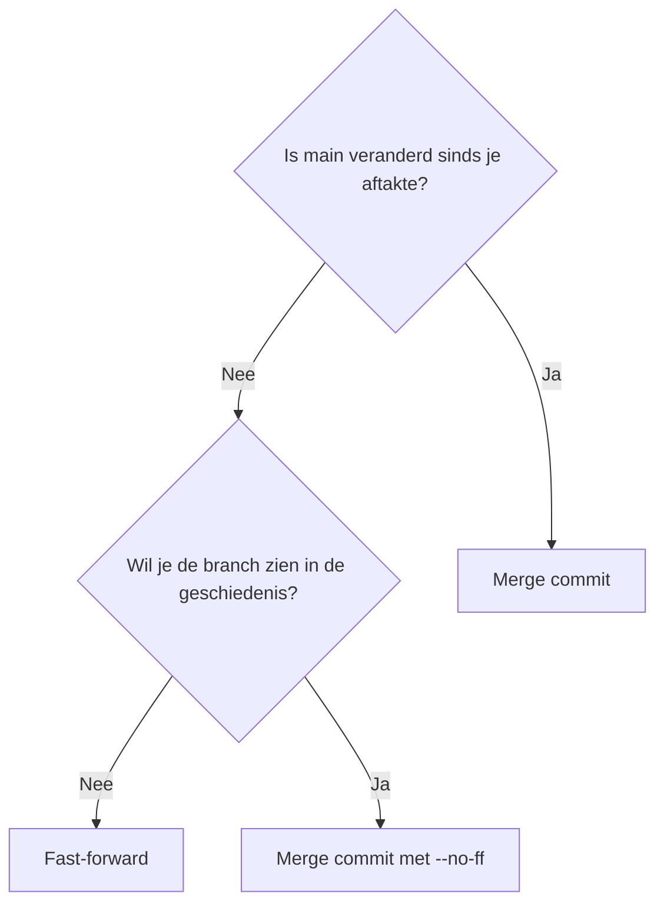
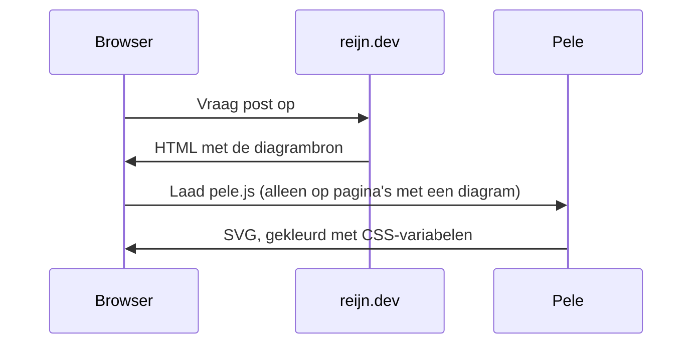

Deze site tekent diagrammen voortaan met [Pele](https://pele.run) in plaats van Mermaid.js. Pele is een kleine bibliotheek met MIT-licentie van het Obsidian-team die dezelfde Mermaid-syntax leest, maar een fractie van de omvang heeft. Om hem meteen aan het werk te zetten: een vraag die opkwam tijdens de overstap. Wat is het verschil tussen een fast-forward en een merge commit?

## Het startpunt

Je maakt een branch van `main`, voegt een paar commits toe op `feature` en wilt die terugbrengen.



Wat Git daarna doet, hangt van één ding af: is `main` veranderd sinds je aftakte?

## Fast-forward

Heeft `main` geen nieuwe commits, dan hoeft Git niets samen te voegen. `main` loopt simpelweg achter, dus Git schuift het label `main` door naar `D`. Er komt geen nieuwe commit bij en de geschiedenis blijft één rechte lijn.



Het nadeel: achteraf zie je niet meer dat `C` en `D` ooit op een aparte branch stonden. Gebruik `git merge --ff-only` als Git alleen een fast-forward mag doen.

## Merge commit

Heeft iemand intussen `E` op `main` gezet, dan zijn de twee geschiedenissen uit elkaar gelopen en valt er niets door te schuiven. Git maakt dan een nieuwe commit `M` met **twee ouders**, die beide lijnen samenvoegt.



De merge commit legt precies vast waar en wanneer de branch binnenkwam. Met `git merge --no-ff` dwing je er een af, ook als een fast-forward mogelijk is. Sommige teams doen dat zodat elke feature als geheel zichtbaar blijft.

## Welke kies je?



Geen van beide is beter. Een lineaire geschiedenis leest makkelijker met `git log`, en merge commits bewaren de context van een branch. Kies per repository één conventie en houd je eraan.

## Hoe de diagrammen hier komen

Elk diagram hierboven is een gewoon ```` ```mermaid ````-codeblok in de Markdown-bron. Een Hugo render hook maakt er een `div` van en markeert de pagina, zodat het script alleen wordt geladen waar het nodig is:



Vergeleken met Mermaid.js ging het script van ongeveer 1,6 MB naar ongeveer 245 kB gzipped. Omdat de kleuren CSS-variabelen zijn, volgen de diagrammen ook de licht/donker-schakelaar zonder opnieuw getekend te worden. Probeer de schakelaar bovenaan de pagina maar eens.
