In April I wrote about [the first cleanup of this site](/posts/2026/04/improving-reijn.dev-performance-privacy-and-a-custom-theme-fork/). Since then I went through it again, file by file. This time I wanted numbers, so I built the site as it was before the changes and as it is now, and measured both the same way.

## The short version

| Page | Lighthouse performance | Largest content visible | Data per visit |
|---|---|---|---|
| Home | 91 → **100** | 3.54 s → **1.50 s** | 387 → **84 KB** |
| About | 91 → **100** | 3.47 s → **1.50 s** | 379 → **79 KB** |
| Posts | 92 → **100** | 3.39 s → **1.35 s** | 377 → **78 KB** |
| A post | 85 → **100** | 4.22 s → **1.43 s** | 383 → **81 KB** |

Every page now loads about 79% less data, and the largest element on screen shows up roughly 2.5 times sooner on a simulated phone.

In both charts below, blue is before and orange is after.

```mermaid
xychart-beta
  title "Data per page view (KB)"
  x-axis [Home, About, Posts, Post]
  y-axis "KB" 0 --> 400
  bar [387, 379, 377, 383]
  bar [84, 79, 78, 81]
```

```mermaid
xychart-beta
  title "Largest Contentful Paint (seconds)"
  x-axis [Home, About, Posts, Post]
  y-axis "Seconds" 0 --> 4.5
  bar [3.54, 3.47, 3.39, 4.22]
  bar [1.50, 1.50, 1.35, 1.43]
```

## Where the bytes went

Almost none of the savings came from clever tricks. They came from not sending things nobody uses.

- **Fonts: 305 KB → 72 KB.** The Inter font files include Cyrillic, Greek, Vietnamese and more. This site uses 14 characters outside plain ASCII, so I cut the fonts down to the Latin range.
- **JavaScript: 62 KB → 0.6 KB.** The theme shipped Prism, a code highlighter that runs in the browser, on every page. Hugo already highlights code when it builds the site, so Prism did nothing.
- **CSS on every page: 52 KB → 19 KB.** Half of it was styling for flag icons of 268 countries. The site shows two.
- **The typing animation on the home page: 13.4 KB → 0.9 KB.** A small library became 30 lines that do the same thing.
- **Diagrams: about 1.6 MB → 245 KB**, only on pages that have one. I replaced Mermaid with [Pele](https://pele.run), which reads the same syntax. The charts above are drawn with it.

## Fixes you can't see in a score

Some of the more important changes don't show up in Lighthouse at all.

- **The security headers never reached the pages.** The Content Security Policy and other headers in `firebase.json` only matched URLs ending in `.html`. Visitors open `/` and `/about/`, so for a long time only `/index.html` was protected. Now every response gets them.
- **Known vulnerabilities in dependencies: 7 → 0**, one of them critical. Dependabot now opens a pull request every week when something needs updating.
- **Post times were off by one or two hours.** The build server runs in UTC and the theme converted dates to the server's time zone.
- **Accessibility: 84–92 → 100 on every page.** Grey text didn't have enough contrast, the menu and theme buttons couldn't be reached with a keyboard, and the language flags were links without a name.
- **Small things:** the mobile menu closed itself while scrolling, Dutch pages showed English labels, the RSS feed left out full posts, and two links were dead.

## Easier to maintain

The theme started as a fork of [hello-friend-ng](https://github.com/rhazdon/hugo-theme-hello-friend-ng). Upstream hasn't changed in almost a year, and my copy had drifted far from it. I moved it into this repository, so a change is now one commit instead of two pull requests and a submodule update. The theme went from about 10,700 lines to 2,600, and the build output from 14 MB to 4.2 MB.

## How I measured

I built both versions locally and ran Lighthouse three times on four pages each, using the median. Lighthouse simulated a mid-range phone on a 4G connection. Data sizes are compressed, the way Firebase sends them. Because it all ran locally, the absolute times are indicative, but both versions ran under exactly the same conditions.

The old post pages also loaded Disqus on the real site. Hugo skips Disqus when you preview locally, so the "before" numbers for posts are, if anything, too kind.
