In april schreef ik over [de eerste opschoonronde van deze site](/nl/posts/2026/04/verbeteringen-aan-reijn.dev-prestaties-privacy-en-een-eigen-thema-fork/). Sindsdien ben ik er opnieuw doorheen gegaan, bestand voor bestand. Deze keer wilde ik cijfers. Daarom heb ik de site gebouwd zoals hij vóór de wijzigingen was en zoals hij nu is, en beide op dezelfde manier gemeten.

## Kort samengevat

| Pagina | Lighthouse-performance | Grootste element zichtbaar | Data per bezoek |
|---|---|---|---|
| Home | 91 → **100** | 3,54 s → **1,50 s** | 387 → **84 KB** |
| About | 91 → **100** | 3,47 s → **1,50 s** | 379 → **79 KB** |
| Posts | 92 → **100** | 3,39 s → **1,35 s** | 377 → **78 KB** |
| Een post | 85 → **100** | 4,22 s → **1,43 s** | 383 → **81 KB** |

Elke pagina laadt nu zo'n 79% minder data, en het grootste element op het scherm verschijnt op een gesimuleerde telefoon ongeveer 2,5 keer zo snel.

In beide grafieken hieronder is blauw vóór en oranje na.

```mermaid
xychart-beta
  title "Data per paginabezoek (KB)"
  x-axis [Home, About, Posts, Post]
  y-axis "KB" 0 --> 400
  bar [387, 379, 377, 383]
  bar [84, 79, 78, 81]
```

```mermaid
xychart-beta
  title "Largest Contentful Paint (seconden)"
  x-axis [Home, About, Posts, Post]
  y-axis "Seconden" 0 --> 4.5
  bar [3.54, 3.47, 3.39, 4.22]
  bar [1.50, 1.50, 1.35, 1.43]
```

## Waar de kilobytes heen gingen

Bijna niets van de winst kwam uit slimme trucs. Het kwam uit het niet meer versturen van dingen die niemand gebruikt.

- **Fonts: 305 KB → 72 KB.** De Inter-fontbestanden bevatten Cyrillisch, Grieks, Vietnamees en meer. Deze site gebruikt 14 tekens buiten gewone ASCII, dus ik heb de fonts teruggebracht tot het Latijnse bereik.
- **JavaScript: 62 KB → 0,6 KB.** Het theme stuurde Prism mee, een code-highlighter die in de browser draait, op elke pagina. Hugo kleurt code al in tijdens het bouwen van de site, dus Prism deed niets.
- **CSS op elke pagina: 52 KB → 19 KB.** De helft was opmaak voor vlaggetjes van 268 landen. De site toont er twee.
- **De type-animatie op de homepage: 13,4 KB → 0,9 KB.** Een kleine bibliotheek werd 30 regels die hetzelfde doen.
- **Diagrammen: zo'n 1,6 MB → 245 KB**, alleen op pagina's die er een hebben. Ik heb Mermaid vervangen door [Pele](https://pele.run), dat dezelfde syntax leest. De grafieken hierboven zijn ermee getekend.

## Fixes die je niet in een score ziet

Sommige van de belangrijkere wijzigingen zie je helemaal niet terug in Lighthouse.

- **De security-headers bereikten de pagina's nooit.** De Content Security Policy en andere headers in `firebase.json` golden alleen voor URL's die op `.html` eindigen. Bezoekers openen `/` en `/about/`, dus lange tijd was alleen `/index.html` beschermd. Nu krijgt elk antwoord ze mee.
- **Bekende kwetsbaarheden in afhankelijkheden: 7 → 0**, waarvan één kritiek. Dependabot opent nu elke week een pull request als er iets bijgewerkt moet worden.
- **Posttijden stonden een of twee uur verkeerd.** De buildserver draait in UTC, en het theme rekende datums om naar de tijdzone van die server.
- **Toegankelijkheid: 84–92 → 100 op elke pagina.** Grijze tekst had te weinig contrast, het menu en de themaknop waren niet met een toetsenbord te bereiken, en de taalvlaggetjes waren links zonder naam.
- **Kleinere dingen:** het mobiele menu klapte dicht tijdens het scrollen, Nederlandse pagina's toonden Engelse labels, de RSS-feed liet volledige posts weg, en twee links waren dood.

## Makkelijker te onderhouden

Het theme begon als fork van [hello-friend-ng](https://github.com/rhazdon/hugo-theme-hello-friend-ng). Het origineel is al bijna een jaar niet veranderd, en mijn kopie was er ver van af gegroeid. Ik heb het in deze repository opgenomen, zodat een wijziging nu één commit is in plaats van twee pull requests en een submodule-update. Het theme ging van zo'n 10.700 naar 2.600 regels, en de build-output van 14 MB naar 4,2 MB.

## Soepeler navigeren

Na het publiceren van deze post heb ik nog een paar nieuwere browserfuncties toegevoegd. Elk is maar een paar regels, en browsers die ze niet ondersteunen gedragen zich precies zoals eerst.

- **Overgangen tussen pagina's.** Wisselen van pagina gaat nu met een vloeiende overgang in plaats van een flits, en de titel van een post schuift van de postlijst naar zijn plek. Dit gebruikt cross-document view transitions (Chrome, Edge en Safari), en staat uit voor bezoekers die minder beweging willen.
- **Direct klikken.** Als je over een link beweegt, rendert Chrome die pagina al op de achtergrond (speculation rules), waardoor de klik meteen voelt.
- **Mooiere regelafbreking.** `text-wrap: balance` voorkomt dat een kop eindigt met één los woord op de laatste regel, en `pretty` doet hetzelfde voor alinea's.
- **Browseronderdelen die het thema volgen.** Met `color-scheme` volgen scrollbalken en formulieren de lichte of donkere modus. De scrollbalk was eerst ook in lichte modus donker.

## Een les over caching

Vlak na het verkleinen van de fonts kregen echte bezoekers nog steeds de oude fonts van 96 KB. Cloudflare, dat vóór deze site staat, had ze opgeslagen onder de oude regel: "bewaar dit bestand een jaar, het verandert nooit". Het legen van de cache loste dat op. Om te zorgen dat het niet opnieuw kan gebeuren, hebben de fontbestanden nu een hash van hun inhoud in de bestandsnaam, zoals `Inter-Regular.a0e995d1….woff2`. Een gewijzigd font krijgt een nieuwe URL, dus fonts kunnen een jaar gecachet worden zonder ooit verouderd te raken.

## Hoe ik heb gemeten

Ik heb beide versies lokaal gebouwd en Lighthouse drie keer op vier pagina's gedraaid, met de mediaan als uitkomst. Lighthouse simuleerde een gemiddelde telefoon op een 4G-verbinding. De datagroottes zijn gecomprimeerd, zoals Firebase ze verstuurt. Omdat alles lokaal draaide, zijn de absolute tijden een indicatie, maar beide versies hadden precies dezelfde omstandigheden.

De oude postpagina's laadden op de echte site ook Disqus. Hugo slaat Disqus over bij een lokale preview, dus de "voor"-cijfers voor posts zijn eerder te gunstig.
